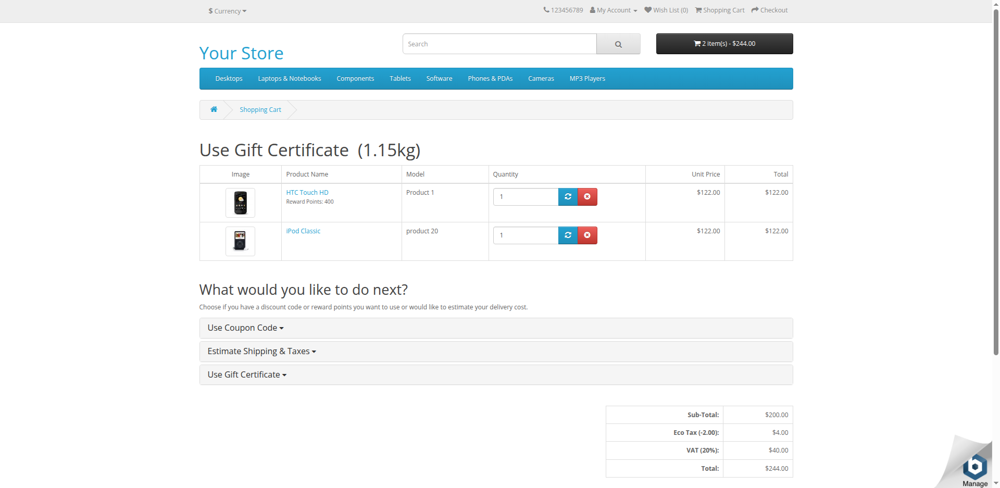
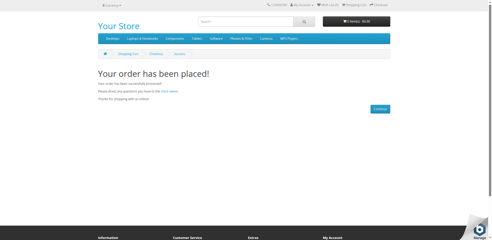

# Evidencias - Compra como invitado en OpenCart

Ejecución en GitHub Actions (`ubuntu-latest`, Java 21, Google Chrome 154 en modo headless) del escenario
**"Compra exitosa de dos productos mediante Guest Checkout"**: **APROBADO** en 22,6 s.

El reporte de una página de Serenity está en [`serenity-summary.html`](serenity-summary.html) (descargarlo y abrirlo en el navegador).
El reporte completo se genera en `target/site/serenity/index.html` al ejecutar `mvn clean verify`.

| # | Paso | Captura |
|---|------|---------|
| 1 | Laura abre la tienda | [01-tienda-opencart.png](capturas/01-tienda-opencart.png) |
| 2 | Busca "iPod Classic" y lo agrega al carrito | [02-producto-1-agregado.png](capturas/02-producto-1-agregado.png) |
| 3 | Busca "HTC Touch HD" y lo agrega al carrito | [03-producto-2-agregado.png](capturas/03-producto-2-agregado.png) |
| 4 | Visualiza el carrito con los 2 productos (total $244.00) | [04-carrito-de-compras.png](capturas/04-carrito-de-compras.png) |
| 5 | Elige Guest Checkout | [05-guest-checkout.png](capturas/05-guest-checkout.png) |
| 6 | Ingresa los datos de facturación (Ecuador / Guayas) | [06-datos-de-facturacion.png](capturas/06-datos-de-facturacion.png) |
| 7 | Acepta los términos y confirma el método de pago | [07-metodo-de-pago.png](capturas/07-metodo-de-pago.png) |
| 8 | Confirma el pedido: **"Your order has been placed!"** | [08-pedido-confirmado.png](capturas/08-pedido-confirmado.png) |

## Carrito con los productos agregados

En esta captura también se ve el defecto descrito en `conclusiones.txt`: el título de la página dice
"Use Gift Certificate" en lugar de "Shopping Cart".

## Confirmación del pedido

